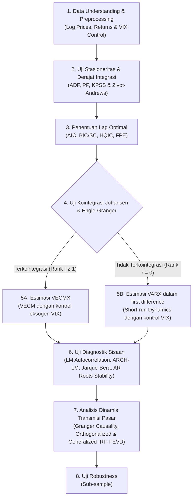

# Rencana Penelitian Ekonometrika: Dinamika Saham NVDA & SKHY (VAR / VECM)

## Deskripsi Tujuan Penelitian (Goal Description)

Penelitian ini bertujuan untuk menganalisis hubungan dinamis, transmisi informasi harga (*price discovery*), serta keterkaitan rantai pasok (*supply chain nexus*) antara **NVIDIA Corporation (NVDA)** sebagai pemimpin pasar akselerator/GPU kecerdasan buatan (*AI Tech Leader*) dan **SK Hynix (SKHY)** sebagai pemasok utama memori *High Bandwidth Memory* dengan mengontrol guncangan sentimen risiko pasar global menggunakan CBOE Volatility Index (VIX).

Dengan menggunakan kerangka ekonometrika runtun waktu multivariat Vector Autoregression with Exogenous Variables (VARX) atau Vector Error Correction Model with Exogenous Variables (VECMX), penelitian ini akan membuktikan secara empiris:

1. Apakah terdapat hubungan ekuilibrium jangka panjang (long-run equilibrium / cointegration) atau hanya keterkaitan fluktuasi jangka pendek (short-run dynamic spillover) antara NVDA dan SK Hynix setelah mengontrol faktor ketidakpastian pasar global (VIX).

2. Siapa yang menjadi penggerak utama pasar (*market leader/driver*) melalui uji kausalitas Granger.

3. Bagaimana mekanisme transmisi guncangan (*shock transmission*) melalui *Impulse Response Function (IRF)* dan seberapa besar kontribusi volatilitas antar-saham melalui *Forecast Error Variance Decomposition (FEVD)*.

---

## User Review Required

> [!IMPORTANT]

> **Penetapan Metodologi Kointegrasi:** 

> Hasil eksplorasi awal pada data historis harian (`NVDA-SKHY_stock_data.csv`, rentang 2022-10-21 hingga 2026-10-30) menunjukkan bahwa seri harga logaritma memiliki derajat integrasi $I(1)$ pada first difference, namun uji kointegrasi Johansen berada pada nilai kritis ambang batas 90% (Trace statistic $\approx 15.44$ vs critical value 95% $15.49$). Oleh karena itu, arsitektur kode akan dirancang adaptif: **menentukan rank dari dua log harga saham, lalu menjalankan VECMX jika terkointegrasi atau VARX dalam first difference jika tidak terkointegrasi; kedua model menggunakan perubahan VIX sebagai kontrol eksogen jangka pendek**. Uji rank standar tidak secara langsung mengontrol VIX, sehingga keterbatasan tersebut harus dilaporkan.

> [!NOTE]

> **Struktur Output Notebook & Modul:**

> Kita akan mengisi notebook kosong yang sudah ada di workspace:

> 1. `notebooks/data-unterstanding.ipynb` (Fase 1)

> 2. `notebooks/uji-stasioner-dan-kointegritas.ipynb` (Fase 2, 3 & 4)

> Serta menambahkan notebook lanjutan untuk pemodelan:

> 3. `notebooks/estimasi-var-vecm-dan-diagnostik.ipynb` (Fase 5, 6, 7)

> 4. `notebooks/structural-break-dan-robustness.ipynb` (Fase 8 & 9)

> Sekaligus menyediakan paket modul Python modular di `src/forecast_saham/` agar analisis dapat dijalankan baik melalui notebook interaktif maupun CLI skrip otomatis.

---

## Rincian 8 Langkah Metodologi Penelitian

### Langkah 1: Data Understanding & Exploratory Data Analysis (EDA)

- **Tujuan**: Memahami karakteristik distribusi, tren, dan perilaku awal data harga serta return saham NVDA dan SKHY.

- **Formulasi Data**:

  - Harga penutupan harian (*Close/Adj Close*): $P_{NVDA, t}$ dan $P_{SKHY, t}$.

  - Logaritma natural harga: $p_{i, t} = \ln(P_{i, t})$.

  - Log return harian: $r_{i, t} = \Delta p_{i, t} = \ln(P_{i, t}) - \ln(P_{i, t-1})$.

  - Harga penutupan VIX sebagai kontrol risiko: $v_t = \ln(VIX_t)$ dan perubahan log VIX: $q_t = \Delta v_t$. Gabungkan ketiga seri pada tanggal perdagangan bersama tanpa mengisi tanggal yang hilang.

- **Pengujian Statistik**:

  - Statistik deskriptif: Mean, Standard Deviation, Skewness, Kurtosis.

  - Uji Normalitas: Jarque-Bera Test ($H_0$: distribusi normal).

  - Rolling Correlation Window (30 hari & 90 hari) untuk mengamati pergeseran korelasi dinamis seiring berkembangnya ekosistem HBM & GPU AI.

  - Visualisasi: Plot level harga historis, time series return harian, histogram & KDE distribusi return, dan matriks korelasi *Pearson* & *Spearman*.

### Langkah 2: Uji Stasioneritas & Derajat Integrasi (Unit Root Testing)

- **Tujuan**: Menentukan apakah seri harga memiliki akar unit (*unit root*) pada level dan menjadi stasioner pada diferensiasi pertama ($I(1)$).

- **Metode Uji**:

  1. **Augmented Dickey-Fuller (ADF) Test**:

     $$\Delta y_t = \alpha + \beta t + \gamma y_{t-1} + \sum_{j=1}^k \delta_j \Delta y_{t-j} + \varepsilon_t$$

     Menguji $H_0: \gamma = 0$ (terdapat unit root / tidak stasioner) dengan 3 spesifikasi deterministik: tanpa konstanta (`n`), dengan konstanta (`c`), dan dengan tren deterministik (`ct`).

  2. **Phillips-Perron (PP) Test**:

     Uji non-parametrik yang tangguh terhadap autokorelasi dan heteroskedastisitas (*Newey-West heteroskedasticity and autocorrelation consistent covariance*).

  3. **KPSS Test (Kwiatkowski-Phillips-Schmidt-Shin)**:

     Uji konfirmatori dengan hipotesis nol terbalik: $H_0: y_t \sim I(0)$ (stasioner). Kombinasi ADF (tolak $H_0$) dan KPSS (gagal tolak $H_0$) memastikan kepastian derajat integrasi.

  4. **Zivot-Andrews Unit Root Test with Structural Break**:

     Menghindari kesimpulan semu (*spurious unit root*) yang disebabkan oleh pergeseran struktural tunggal pada intersep atau tren akibat ledakan AI.

  5. Terapkan uji stasioneritas yang sama pada $v_t$ dan $q_t$. Gunakan $q_t$ sebagai kontrol utama dalam model; level VIX hanya digunakan sebagai kontrol alternatif jika stasioner.

### Langkah 3: Penentuan Panjang Lag Optimal (Lag Selection)

- **Tujuan**: Memilih jumlah lag $p$ yang meminimalkan kehilangan informasi tanpa menyebabkan *overfitting* atau *loss of degrees of freedom*.

- **Kriteria Evaluasi**:

  - Akaike Information Criterion (AIC): $\text{AIC}(m) = \ln |\hat{\Sigma}_m| + \frac{2 m K^2}{T}$

  - Schwarz Bayesian Criterion (BIC / SC): $\text{BIC}(m) = \ln |\hat{\Sigma}_m| + \frac{\ln(T) m K^2}{T}$

  - Hannan-Quinn Criterion (HQIC)

  - Final Prediction Error (FPE)

  - **Strategi**: Menganalisis rekomendasi lag $1 \le p \le 10$ pada sistem dua saham dengan kontrol perubahan VIX, lalu memilih lag yang menghasilkan sisaan bebas autokorelasi.

### Langkah 4: Uji Kointegrasi (Johansen & Engle-Granger)

- **Tujuan**: Menguji keberadaan hubungan ekuilibrium jangka panjang stasioner antara harga saham NVDA dan SKHY.

- **Peran VIX**: Pengujian rank Johansen dilakukan pada dua log harga saham. VIX tidak dimasukkan ke vektor kointegrasi karena berperan sebagai kontrol eksogen jangka pendek, bukan variabel ekuilibrium. Uji Johansen standar tidak mengondisikan rank pada VIX; nyatakan batasan tersebut dan lakukan analisis sensitivitas dengan spesifikasi model yang memasukkan kontrol VIX.

- **Spesifikasi Johansen**:

  - Matriks $\Pi = \alpha \beta'$ pada model Vector Error Correction:

    - *Trace Test*: $\lambda_{\text{trace}}(r) = -T \sum_{i=r+1}^K \ln(1 - \hat{\lambda}_i)$

    - *Maximum Eigenvalue Test*: $\lambda_{\max}(r, r+1) = -T \ln(1 - \hat{\lambda}_{r+1})$

  - Pemilihan asumsi tren deterministik (Case 2: restricted constant pada kointegrasi, atau Case 3: unrestricted constant).

- **Uji Engle-Granger 2-Langkah**:

  - Regresi $p_{NVDA, t} = \theta_0 + \theta_1 p_{SKHY, t} + u_t$, kemudian uji stasioneritas residual $\hat{u}_t$ menggunakan ADF.

- **Aturan Keputusan Model**:

  - **Jika $r \ge 1$**: Gunakan **VECMX** untuk menangkap koreksi jangka panjang dan dinamika jangka pendek dengan perubahan VIX sebagai kontrol.

  - **Jika $r = 0$**: Gunakan **VARX dalam first difference** untuk dinamika jangka pendek tanpa memaksakan hubungan jangka panjang yang tidak ada, dengan perubahan VIX sebagai kontrol.

### Langkah 5: Estimasi Model (VARX atau VECMX)

- **Spesifikasi VECMX** (apabila $r=1$):

  $$\Delta \mathbf{y}_t = \boldsymbol{\mu} + \boldsymbol{\alpha}\left(\beta'\mathbf{y}_{t-1} + c\right) + \sum_{i=1}^{p-1}\boldsymbol{\Gamma}_i\Delta\mathbf{y}_{t-i} + \boldsymbol{\Psi}_0 q_t + \sum_{j=1}^{s}\boldsymbol{\Psi}_j q_{t-j} + \boldsymbol{\varepsilon}_t,$$
  dengan $\mathbf{y}_t = [p_{NVDA,t}, p_{SKHY,t}]'$ dan $q_t = \Delta\ln(VIX_t)$. VIX dan lag-nya adalah regressor eksogen dalam persamaan jangka pendek, bukan bagian dari $\beta'\mathbf{y}_{t-1}$.

- **Interpretasi Parameter Utama**:

  - Koefisien ekuilibrium $\beta$: Elastisitas jangka panjang harga NVDA terhadap harga SKHY.

  - Koefisien kecepatan penyesuaian $\alpha$: Seberapa cepat deviasi dari ekuilibrium dikoreksi kembali setiap harinya. Jika $\alpha_{SKHY}$ signifikan sedangkan $\alpha_{NVDA}$ tidak, maka NVDA adalah *leader* eksogen murni yang memimpin pergerakan pasar.

- **Spesifikasi VARX dalam first difference** (apabila $r=0$):

  $$\Delta \mathbf{y}_t = \mathbf{c} + \sum_{i=1}^p \mathbf{\Phi}_i \Delta \mathbf{y}_{t-i} + \boldsymbol{\Psi}_0 q_t + \sum_{j=1}^{s}\boldsymbol{\Psi}_j q_{t-j} + \boldsymbol{\varepsilon}_t$$

  Dengan demikian, kedua cabang model merupakan model bersyarat pada perubahan VIX (VECMX atau VARX dalam first difference).

### Langkah 6: Uji Diagnostik Sisaan (Residual Diagnostics)

- **Tujuan**: Memvalidasi bahwa residual model bebas dari pelanggaran asumsi ekonometrika runtun waktu:

  1. **Uji Autokorelasi Multivariat**: Breusch-Godfrey Lagrange Multiplier (LM) Test dan Portmanteau Q-statistic ($H_0$: tidak ada autokorelasi sisaan hingga lag $k$).

  2. **Uji Heteroskedastisitas**: AutoRegressive Conditional Heteroskedasticity (ARCH-LM) Test ($H_0$: varians sisaan homoskedastis).

  3. **Uji Normalitas Multivariat**: Jarque-Bera Multivariate Normality Test.

  4. **Uji Stabilitas Model**: Menghitung *characteristic roots* dari matriks pendamping (*companion matrix*). Semua modulus akar polinomial harus berada di dalam lingkaran satuan ($|\lambda_i| < 1$).

### Langkah 7: Analisis Dinamis Transmisi Pasar

- **Granger Causality Test**:

  - Menguji hipotesis bahwa lag return NVDA/SKHY tidak memengaruhi return saham pasangannya dengan lag perubahan VIX tetap sebagai kontrol. VIX tidak dimasukkan sebagai arah kausalitas endogen.

  - Menentukan apakah hubungan kausalitas bersifat satu arah ($NVDA \rightarrow SKHY$ atau $SKHY \rightarrow NVDA$), timbal balik (*bidirectional feedback*), atau tidak saling mempengaruhi.

  - Opsi pendekatan **Toda-Yamamoto (1995)** pada level VARX($p + d_{\max}$), dengan VIX sebagai kontrol eksogen, jika terdapat ketidakpastian integrasi untuk menghindari bias pra-pengujian (*pre-testing bias*).

- **Impulse Response Function (IRF)**:

  - Mensimulasikan dampak guncangan (*one standard deviation shock*) dari NVDA terhadap SKHY dan sebaliknya sepanjang horison 10 hingga 20 hari bursa ke depan, dengan jalur kontrol VIX dikondisikan tetap.

  - Analisis sensitivitas menggunakan **Cholesky Orthogonalization** (urutan $NVDA \to SKHY$ vs $SKHY \to NVDA$) dan **Generalized Impulse Response (GIRF)** yang tidak tergantung pada urutan variabel.

- **Forecast Error Variance Decomposition (FEVD)**:

  - Menghitung proporsi varians kesalahan peramalan return saham yang dijelaskan oleh inovasi saham sendiri dan saham pasangannya pada horison $h = 1, 5, 10, 20$ hari, kondisional pada VIX. VIX tidak memperoleh porsi FEVD karena bukan variabel endogen. Sajikan respons terhadap guncangan VIX sebagai simulasi eksogen terpisah bila diperlukan.

### Langkah 8: Uji Ketahanan (Robustness Checks)

- **Uji Sub-sampel (Sub-sample Analysis)**:

  - Membagi sampel menjadi dua periode: *Early Stage AI Boom* (Okt 2022 – Mei 2023) vs *Massive Commercialization & HBM Boom* (Jun 2023 – Okt 2026).

  - Menguji apakah koefisien transmisi dan kausalitas semakin menguat pada periode pasca-booming.

- **Sensitivitas Spesifikasi Lag**:

  - Menguji ulang model dengan lag $p-1$ dan $p+1$ untuk membuktikan bahwa temuan IRF dan FEVD tidak artefak dari lag tertentu.

---
